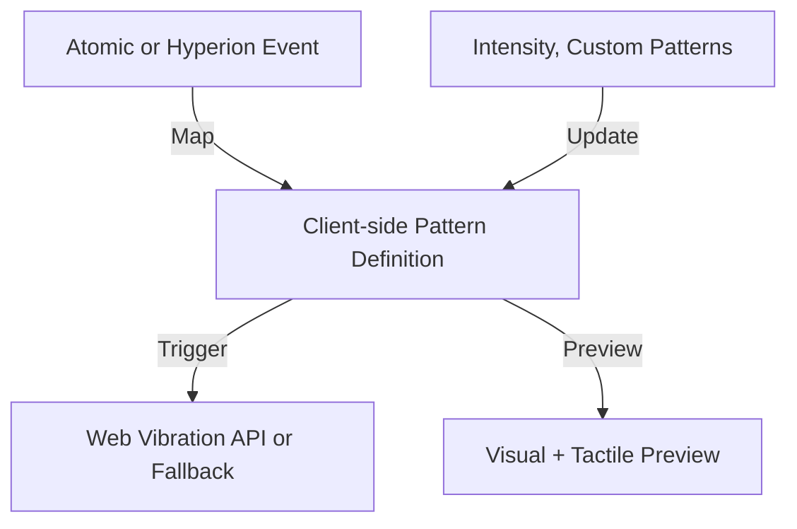

# wax-haptic-feedback-simulator — Haptic Feedback Simulator for On-Chain Events

> **Status:** 🔒 Private (In Development) | Target Public Release: August 2026  
> **Category:** Accessibility & Inclusive Design  
> **Parent Catalog:** [pixel-journey/wax-ecosystem-blueprint-catalog](https://github.com/pixel-journey/wax-ecosystem-blueprint-catalog)

**One-sentence goal:** A web-based haptic feedback simulator that maps on-chain events, interactions, and NFT states to vibration patterns and tactile responses, enabling accessible, immersive, and inclusive experiences for users with different sensory needs on WAX.

---

## 1. Overview & Goal

This blueprint brings tactile feedback to Web3 interactions. It makes on-chain events feel physical and accessible.

- **Why it matters for WAX:** Accessibility is core to inclusive Web3. Haptic feedback opens new dimensions for immersion and accessibility (e.g. for visually impaired users or immersive experiences).
- **Public infrastructure only:** Client-side vibration API (where supported), mapping rules from on-chain data. No custom contracts.
- **Target users:** Accessibility-focused projects, immersive experience creators, users with sensory preferences, game designers.
- **Success metrics:** "Feel on-chain events through meaningful haptic patterns", "Customizable intensity and mappings", "Graceful fallback on devices without haptics".

---

## 2. Concepts & Inspiration

- **Core concepts:** On-chain events (transfers, mints, interactions) can be mapped to vibration patterns (short/long pulses, rhythms). Client uses the Vibration API or simulates it visually/audibly as fallback.
- **Pain points:** Most Web3 experiences are purely visual/auditory. Haptic adds a powerful new layer for accessibility and immersion.
- **Inspirations:** Mobile game haptics, accessibility tools with tactile feedback, modern web haptic experiments. Web3: on-chain events as tactile signals.
- **Cross-references:** Perfect with accessibility blueprints (reduced-motion, screen-reader, cognitive-load), gaming, and immersive audiovisual tools.

---

## 3. Design Specifications (Pixel Journey Standards)

### 3.1 Visual & Interaction Design
- Clean simulator interface with event triggers and live haptic preview.
- Main view: Visual representation of vibration patterns + intensity controls.
- Controls: Event selector, intensity slider, custom pattern editor, test buttons.
- Micro-interactions: Visual pulse synced with haptic, smooth intensity changes.
- Responsive: Full simulator on desktop; simplified mobile preview with real haptics where available.

### 3.2 Key Views / Components
- `HapticSimulator.tsx` — Main interactive simulator.
- `PatternEditor.tsx` — Visual editor for creating custom vibration patterns.
- `EventMapper.tsx` — Mapping on-chain events to haptic patterns.
- `IntensityControls.tsx` — Global and per-pattern intensity settings.
- `FallbackPreview.tsx` — Visual/audible simulation for devices without haptics.

### 3.3 Accessibility (A11y) & Inclusive Design
- WCAG 2.2 AA: Full keyboard support, screen reader descriptions of patterns, high contrast.
- Clear explanations of haptic meaning.
- Strong fallback modes (visual pulses, sound).

### 3.4 Performance & Optimization Targets
- Lightweight vibration API usage.
- Instant pattern playback.
- Efficient mapping logic.

---

## 4. Technical Architecture

### 4.1 Core Tech Stack
- Next.js 15 + TypeScript + Tailwind + shadcn/ui
- Web Vibration API (navigator.vibrate) with graceful fallback
- Simple pattern definition system (arrays of durations)
- @tanstack/react-query for on-chain event examples
- AtomicAssets/Hyperion for example events

### 4.2 Data Flow Diagram


### 4.3 Folder Structure
```
app/
├── components/
│   ├── haptic/
│   │   ├── HapticSimulator.tsx
│   │   └── PatternEditor.tsx
│   └── mapper/
│       └── EventMapper.tsx
├── hooks/useHapticFeedback.ts
├── lib/
│   ├── haptic/
│   │   └── pattern-engine.ts
│   └── wax/
│       └── event-mapper.ts
└── types/haptic.ts
```

### 4.4 Security & Privacy
- Purely client-side. No data sent.

---

## 5. Implementation Examples & Code Snippets

**Core haptic hook**
```ts
// hooks/useHapticFeedback.ts
export function useHapticFeedback() {
  const triggerHaptic = (pattern: number[]) => {
    if ('vibrate' in navigator) {
      navigator.vibrate(pattern);
    } else {
      // Fallback visual/audible simulation
    }
  };

  return { triggerHaptic };
}
```

**Pattern example**
```ts
const mintPattern = [100, 50, 100]; // Short pulse, pause, short pulse
```

---

## 6. Demo & Testing
- Demo mode with sample on-chain events and haptic mappings.
- Interaction tests: trigger patterns, custom editor, intensity changes.
- Fallback tests on devices without vibration API.
- Accessibility flow tests.

---

## 7. Roadmap
Phases: Haptic engine + pattern system → Simulator UI with event mapping → Polish, a11y, fallback modes → full documentation.

Future: Integration with other accessibility tools, real device testing suite, advanced pattern libraries.

---

## 8. Visual References
> Clean, modern accessibility tools with satisfying haptic previews. Clear visual representation of patterns, intuitive editor. Reference: high-quality haptic design tools and accessibility simulators.

---

## 9. Related Blueprints
- Other accessibility blueprints (reduced-motion, screen-reader, cognitive-load).
- Gaming and immersive audiovisual tools.

---

## 10. License & Credits
MIT. Built for inclusive and immersive haptic experiences on WAX.

**Pixel Journey — Beautiful interfaces for public blockchain data.**
